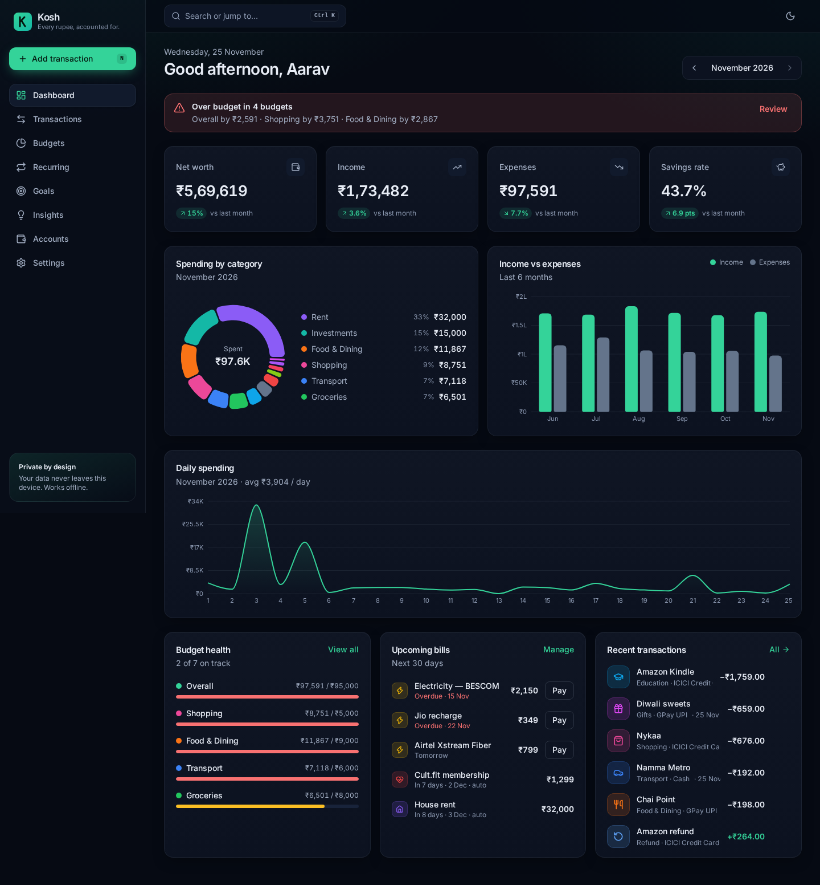
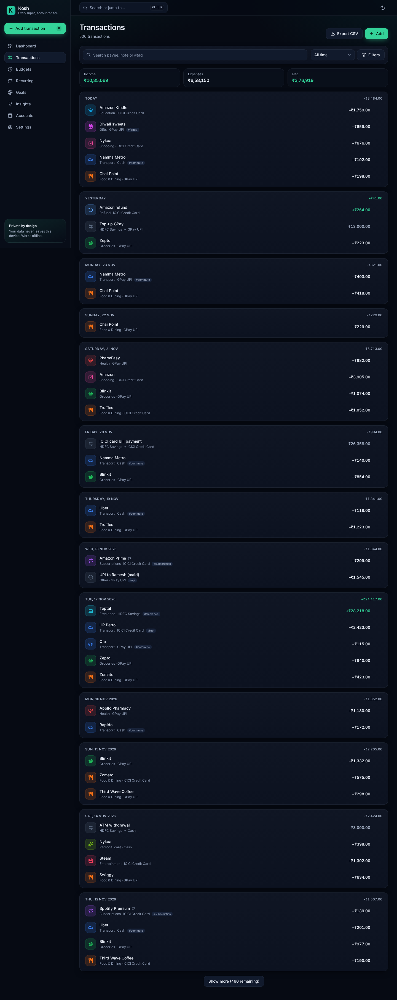
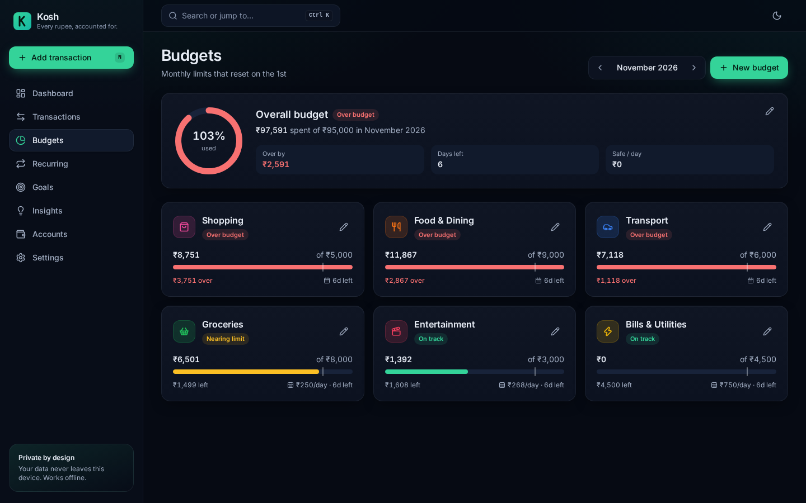
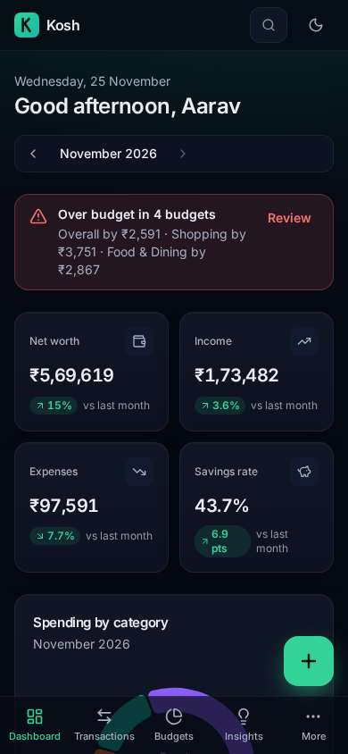

<p align="center"></p>

<h1 align="center">Kosh</h1>
<p align="center"><b>Every rupee, accounted for.</b><br>A premium, privacy-first expense tracker that runs entirely in your browser.</p>

<p align="center"><a href="https://jarvis-expense-tracker.vercel.app"><b>Live demo →</b></a></p>



## Features

Inspired by what today's leading trackers offer (YNAB, Monarch Money, Copilot Money, Spendee, Wallet by BudgetBakers, Money Manager, axio):

- **Transactions**: income, expenses and transfers between accounts, with categories, payee, notes, tags and undo on delete
- **Quick add**: press <kbd>N</kbd> or tap the + button. <kbd>Ctrl</kbd>/<kbd>⌘</kbd>+<kbd>K</kbd> opens a command palette for navigation and search
- **Accounts and wallets**: cash, bank, credit card and UPI, with live balances and net worth
- **Budgets**: monthly budgets per category plus an overall budget, with on-track, 80% warning and over-budget states, days left and a safe-to-spend-per-day figure
- **Recurring and subscriptions**: daily, weekly, monthly and yearly rules, an upcoming-bills list, one-tap "Pay", auto-posting with no duplicates, and your monthly subscription cost
- **Dashboard**: KPI cards with month-over-month deltas, a spending-by-category donut, 6-month income vs expenses, daily spending, budget health, upcoming bills and recent activity
- **Insights**: top categories, biggest expenses, month-over-month change by category, average daily spend, a weekday pattern and plain-language insight cards
- **Search and filters**: text, date presets or a custom range, type, categories, account, amount range and sort, grouped by day with daily totals
- **Savings goals**: target, deadline, contributions, a progress ring and the monthly saving needed
- **Your data**: CSV export, CSV import with column mapping, JSON backup and restore, reset to demo data, and clear all
- **INR first**: ₹ with Indian lakh grouping by default, with INR, USD, EUR, GBP, AED or SGD for display
- **Dark, light and system themes**, a responsive desktop sidebar and mobile bottom nav, and an installable PWA that works offline
- **Accessible**: keyboard navigation, focus-trapped dialogs, ARIA labels and WCAG AA contrast checked with axe

### Not included (these need a backend)
Bank or SMS auto-sync, shared household wallets, AI receipt scanning and cross-device sync. Kosh stores everything locally under `kosh:v1:*` in `localStorage`. Your data never leaves your device.

## Screenshots

| Transactions | Budgets | Mobile |
|---|---|---|
|  |  |  |

## Tech stack
Vite · React 19 · TypeScript (strict) · Tailwind CSS v4 · Motion · Recharts · Zustand · date-fns · lucide-react · vite-plugin-pwa. Money is stored as integer paise to avoid floating-point errors.

## Getting started
```bash
npm install
npm run dev        # http://localhost:5173
npm run build      # typecheck + production build
npm run typecheck
```

## Tests
The Playwright E2E suite covers desktop at 1440×900 and mobile at 390×844. It tests every page, the workflows, persistence, console errors, overflow, and axe accessibility and contrast checks in both themes.
```bash
npx playwright install chromium
npm run build && npm run test:e2e
BASE_URL=https://jarvis-expense-tracker.vercel.app npm run test:e2e   # against the live site
```

## Deploy
The app is deployed on Vercel, and every push to `main` deploys automatically. `vercel.json` rewrites every route to `index.html` so the app's routing works.
